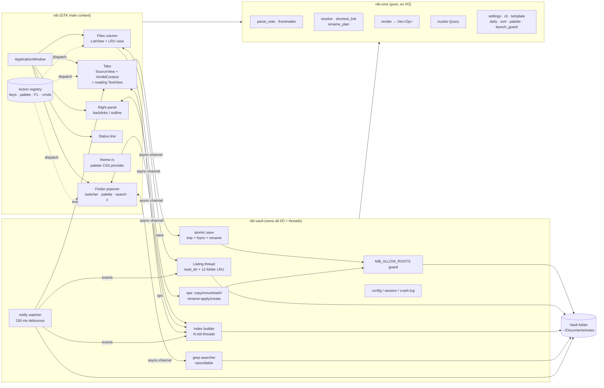

# nib — DISCOVERY.md

> Discovery held 2026-10-16 with the owner. **Precedence: SCOPE.md > DISCOVERY.md > PROMPT.md.** Where this file and PROMPT.md disagree, this file wins; SCOPE.md (written by the Goal A agent per PROMPT §0.1) must fold every decision below in.

## 1. Decisions

| # | Topic | Decision | Overrides |
|---|---|---|---|
| D1 | Vault | `~/Documents/notes` (73 notes, `.obsidian/`, no tags, not yet git) becomes the single source of truth. folio (zzzbox, https://notes.lan) is **retired** at switch-over (§6). Until then the zzzbox volume is the live copy and the local folder is stale — nobody edits it. | — |
| D2 | Success | nib is the owner's **daily driver**: PROMPT §26 passes, then a week of real use on the real vault with Obsidian and folio unopened. | — |
| D3 | Scope | **Full spec**, all 10 slices. No cuts beyond D9. | — |
| D4 | Agents | ~~Slice split~~ **Superseded 2026-10-16 by SCOPE §2:** split by role. **Goal A = Codex, Phases 1–4** (`nib-core` + `nib-vault`: all logic, I/O, threads, scripts) → `HANDOFF-A.md` → **Goal B = Claude, Phases 5–9** (the whole GTK app, design assets, UI checks) → `HANDOFF-B.md` → **Goal C = Codex, Phase 10** (review A+B, ship, acceptance). Goal B may make *additive* changes to core/vault, logged in SCOPE. | PROMPT §0.2 vertical slices |
| D5 | Rhythm | Atomic commits, **push at the end of every green slice**, no review gates until Goal C. Commit as `codedsleep <purchases91027@pm.me>` (already the repo's config). Branch `master`. | §23 "one slice per PR-sized series" — no PRs, direct to master |
| D6 | Perf judge | The **thinkpad** is the machine the §21 budgets are judged on. Agents work on this workstation and aim for **≤ 60 % of each budget here** to leave headroom. Goal C produces the README table from a `NIB_TRACE=1` fixture run on the thinkpad (over ssh with headless `cage` if that works, else the owner runs `scripts/dev-run.sh` there and pastes the output). | §21 "2020-class laptop" |
| D7 | Budgets | **Gated per slice, reported in `check.sh`.** Each slice's "done when" measures its budget once and records the number in SCOPE. `check.sh` prints `start_to_map` and the other numbers, but only fails if the window doesn't map. | §24 "asserts start_to_map under budget" |
| D8 | Vault git | At switch-over the vault is `git init`ed and committed once (§6). nib stays git-unaware: no git crate, no auto-commit. §26's `git status` check runs against that repo. | — |
| D9 | No hard delete | **`D` is removed.** `d` / `:trash` always use `gio::File::trash`. If trashing fails (no trash dir on that filesystem), nib refuses with a notice and **never** deletes as a fallback. `nib-vault::ops::delete` is not written, and the mount-point/symlinked-folder rules in §8 go with it. | §8 delete op, §17 `d, D` row |
| D10 | Launch guard | nib **never launches** a file that has the exec bit, ends in `.desktop`/`.AppImage`/`.run`/`.sh`, or sniffs as `application/x-executable`, `x-sharedlib`, `x-shellscript`, `x-desktop`. It shows `refused to run <name> — cp copies its path` instead. External links launch only for `http`, `https` and `mailto`; any other scheme (`file:`, `javascript:`, custom handlers) gets a notice. The classifier is a pure function in `nib-core` (it takes the name, mode bits and content type); the caller supplies the facts. It covers `Alt+Enter`, `Ctrl+click`, reading-view link clicks and opening from the files column. | §8 "everything else is launched", §9 follow link |
| D11 | Agent confinement | Trek's model: when `NIB_ALLOW_ROOTS` is set, nib refuses every write outside the listed roots plus the fixture and temp dir. When it's unset, the shipped build is unconfined. `dev-run.sh`, `agent/checks/*` and `check.sh` (an empty value before `cargo test`) always set it. **Agents never open, write or watch `~/Documents/notes`.** The only exception is Goal C copying it (`cp -a`) to `~/.cache/nib-acceptance/` for §26, and that copy is a git repo. | §24 dev-run (extends it to tests and checks) |
| D12 | Name / repo | App **nib**, app id `io.github.codedsleep.Nib`. **The repo stays private.** It's currently `codedsleep/markdown-trekfm-rust`; renaming it to `codedsleep/nib` (folder `~/code/nib`) is proposed, pending the owner's OK (§7 O-1). `.planning/` **stays tracked** while private, so handoffs travel with the repo. Untrack it if the repo ever goes public. | — |
| D13 | Install | Root `install.sh` fetches with **`gh release download`** (requires `gh auth status`; prints the fix if missing), verifies `SHA256SUMS`, installs into `~/.local` (bin, desktop file, icon, man page, style schemes). Flags: `--prefix`, `--version vX`, `--uninstall`, `-y` (required from agent shells without a tty). It checks for the GtkSourceView 5 runtime and prints the `dnf install` line if it's missing. No curl fallback until the repo is public. | §25.10 "curl \| sh", done-when |
| D14 | CI | **`release.yml` on `v*` tags only**: x86_64 on `ubuntu-24.04` (GTK 4.14 / GtkSourceView 5.12, which meets the floors), with `SHA256SUMS`. aarch64 only if `ubuntu-24.04-arm` runs for a private repo at no cost; otherwise drop it and note that in the README (§7 O-2). No check-on-push workflow; `scripts/check.sh` is the gate. | §24 CI, §5 workflows |
| D15 | Theme | **Port trek's palette:** the pure part of `trek-core::palette` (GTK 3 `@define-color` parsing plus stylesheet recolouring) becomes `nib-core::palette`. Finding and reading the theme files goes in `nib-vault` (it's I/O); loading the provider goes in `nib/src/theme.rs`. `NIB_GTK_THEME` overrides it for agent runs (trek's `TREK_GTK_THEME`). The dark variant is preferred when the theme has one (trek's behaviour). The owner's theme is `NordArc-Theme`, which is GTK 3 only. The editor and reading view still take colours from the GtkSourceView scheme (`nib-nord`). The pure palette lands in Phase 2 (Codex), theme discovery in Phase 3 (Codex), and the loader in Phase 5 (Claude). | §20 "not ported", §27 item |
| D16 | Trek hookup | Trek keeps sending `.md` files to `$EDITOR`. Changing that is out of scope and moves to PROMPT §27. nib's `.desktop` still registers `text/markdown`. | — |
| D17 | Trek reference | trek's source isn't on this machine (only `~/.local/bin/trek`). Phase 1.1 clones `codedsleep/trek` to `~/code/trek` as a **read-only reference** and never commits there. Clipboard-interop checks use the installed trek binary. | — |

## 2. Spec gaps fixed here

These are holes found in PROMPT.md while reading it for discovery. Each line is binding.

1. **`Alt+T` collision.** §14 gives `Alt+T` to templates and §15/§17 give it to new tab. Resolution: `Alt+T` = new tab, `Alt+Shift+T` = insert template (as §17 has it).
2. **`Ctrl+V` collision.** §10 says `Ctrl+V` belongs to vim (visual block in normal mode, literal insert in insert mode), while §14/§17 make it paste-image. Resolution: `Ctrl+V` pastes an image **only in insert mode (or with vim off) and only when the clipboard offers a `gdk::Texture`**. Otherwise the key goes to vim untouched. There is also a palette action and `:paste-image` that work in any mode.
3. **Insert-mode detection is locale-dependent.** §9 keys list continuation off `command-bar-text == "-- INSERT --"`, but GtkSourceView translates that string. Compare against `glib::dgettext(Some("gtksourceview-5"), "-- INSERT --")`, computed once, and add a headless check run under a non-English `LANG`.
4. **Esc routing.** The window-level `Esc` ("close any popover; clear selection") must never fire while the editor has focus and vim consumed the key. A headless check covers it: `Esc` in vim insert mode leaves the files-column selection intact.
5. **Symlinked notes.** Atomic save (§16) must resolve a symlink and write the temp file beside the **target**, so the symlink stays a symlink. The same applies to rename-plan rewrites.
6. **Crates the spec uses but doesn't list.** Add `gdk-pixbuf` (§11 image decode at scale), `log` (§22), and dev-dependency `tempfile` (§23 tempdir vaults). The vault key (§15) uses `glib::compute_checksum_for_str(ChecksumType::Sha256, …)` in `nib`, so no `sha2` crate is needed.
7. **Trash and Obsidian's `.trash/`.** nib uses the XDG trash, not the vault's `.trash/`. `.trash/` stays hidden and is never written (§3 table is unchanged).
8. **Example path.** §19's sample `last = "/home/percy/notes"` becomes `"/home/zzz/Documents/notes"` in the generated defaults comment. (It's cosmetic; `last` is written by nib anyway.)

## 3. Recommended stack

The stack is PROMPT §4 unchanged, plus D15 (palette port) and gap 6 (the `gdk-pixbuf`, `log` and `tempfile` crates). It's justified because:

- **GTK 4 + GtkSourceView 5, no libadwaita, no WebKit.** That's the only route to the §21 RSS and start-up budgets, and trek proves the gtk4-rs patterns on this desktop (Hyprland, NordArc).
- **One parser (pulldown-cmark 0.13+, `ENABLE_WIKILINKS`)** for both the index and the reading view, so links never disagree between them. Folio's split-view latency came from re-parsing on every key; nib's idle-debounced render avoids that by design.
- **`VimIMContext`** rather than a hand-rolled vim. Its known gaps (no `:map`, no `gf`) are an accepted trade, listed in the README.
- **std threads + `async-channel` only.** No tokio or rayon, which keeps it to one runtime (GLib's main context).

Machine facts (2026-10-16): Rust 1.98.1 (Fedora), rustfmt 1.9 working, GTK 4.22.5 devel installed, **GtkSourceView 5.20 devel not installed**, **`scdoc` not installed**, `cage` present, `weston` absent, `gh` and `codex` present.

## 4. Architecture

The rules are PROMPT §5 and §23: core sees `NoteId`s and `&str`, never paths or GTK; vault never exposes GTK types; and every cross-thread result travels over one `async-channel`.

## 5. Security and safety checklist

The threat model is a single local user, no network and no auth. The asset to protect is the notes. Each item names the check or test that proves it.

- [ ] **Atomic save**: temp file beside the target, `fsync`, permissions copied, `rename`. Symlinks resolved (gap 5). Proven by the kill -9 test in §26 and the round-trip check.
- [ ] **Bytes preserved**: line endings, BOM, trailing newline and indentation style survive an open+save with no edits. Covered by a `nib-vault` test over every fixture file and a headless check.
- [ ] **No vault pollution**: nib writes only notes, attachments and daily notes the user asked for, plus transient `.*.nib-tmp`. Never `.obsidian/`, `.trash/` or any dotfolder. A `nib-vault` test walks the fixture after a full check run and diffs it.
- [ ] **Stale temp cleanup** only matches `.*.nib-tmp` older than 1 min, and never follows symlinks.
- [ ] **Trash only** (D9). No code path calls `remove_file`/`remove_dir_all` on vault content. Goal C greps for it.
- [ ] **Rename rewrites are opt-in** (`ask` default), applied with atomic writes and highest byte offset first, and open buffers are patched rather than reloaded. Covered by the rename check.
- [ ] **External change never clobbers**: a modified buffer is never auto-reloaded and `:w` is an explicit overwrite. Covered by the external-change check.
- [ ] **Launch guard** (D10): no executables, no `.desktop`, schemes limited to http/https/mailto. Unit tests on the classifier, plus a headless check that follows a link to `attachments/evil.sh` in the fixture.
- [ ] **Templates never execute** anything: `{{…}}` expansion is substitution only. A unit test feeds it shell-looking input.
- [ ] **Remote images are never fetched**: reading view shows the link text. nib makes zero network calls (Goal C checks with `strace -f -e trace=network` on a fixture run).
- [ ] **Confinement** (D11) is set in every agent and dev entry point. Agents never touch `~/Documents/notes`.
- [ ] **Paths stay inside the vault**: a link or `:e ../../etc/passwd` resolving outside the vault root opens nothing and shows a notice. Created and attachment paths are joined and then checked with `starts_with(root)` after canonicalisation.
- [ ] **Crash log** holds message, backtrace, versions and vault key only, never note text or note paths beyond the panicking location.
- [ ] **`NIB_LOG=debug`** may print note paths but never note contents.
- [ ] **No `unsafe`** (`forbid` in all three crates), no `unwrap` outside tests or proven invariants.

## 6. Switch-over (owner, after Goal C acceptance)

1. On zzzbox, run folio's `deploy/pull-notes.sh --dry-run` from the folio checkout, then for real, into `~/Documents/notes`.
2. `cd ~/Documents/notes && git init && printf '.*.nib-tmp\n' > .gitignore && git add -A && git commit -m "Vault at switch-over"`.
3. On zzzbox, `systemctl --user stop folio.service && systemctl --user disable folio.service`. Keep the volume for a month as a backup.
4. `install.sh -y` on the workstation and the thinkpad, then add `bind = $mainMod, N, exec, nib` to Hyprland.
5. Week of daily use. `git status` in the vault at the end is §26 item 1.

## 7. Open questions

- **O-1** Rename the repo `codedsleep/markdown-trekfm-rust` → `codedsleep/nib` and the folder → `~/code/nib`? This is recommended, and best done before Goal A starts. (Owner's call; outward-facing.)
- **O-2** aarch64 release on a private repo: only if the arm runner is free. If not, the release is x86_64 only. Goal C decides and records it.
- **O-3** Thinkpad trace over ssh + headless `cage`: Goal C tries it first, and falls back to the owner running `scripts/dev-run.sh` there.

## 8. Implementation roadmap

Superseded by **SCOPE.md §6** (10 phases, grouped by agent: Codex 1–4, Claude 5–9, Codex 10).

## 9. Risks

| Risk | Likelihood | Impact | Mitigation |
|---|---|---|---|
| **≤ 150 ms start on the thinkpad.** GTK 4 renderer init and GtkSourceView language loading eat most of it. | Medium | Medium | Measure in slice 1 on the thinkpad, not just here. Load the language and scheme lazily after `present()` if needed (render plain first, highlight on idle). Don't switch `GSK_RENDERER` to win numbers. |
| **≤ 90 MB idle RSS.** GTK 4 GL plus three SourceViews is near that alone. | Medium | Low | Measure in slice 1 and again in slice 9. Reading views are built lazily, and the tag table is shared. If it's still over, record the real number. It's a daily-driver app, so this doesn't block. |
| **VimIMContext gaps** (no `:map`, odd `p` with the system clipboard, `execute-command` claiming order). | High | Medium | Slice 2 spikes `execute-command`, `command-bar-text` and the `write`/`edit` signals first. Gaps go in the README's Vim section. No reimplementation (§10). |
| **Codex reviews its own Goal A** (D4 + D5, review only at the end). | Medium | Medium | Goal B starts by reading A's code and logs anything off in HANDOFF-B §"Goal A findings" for C to act on. |
| **Horizontal split**: Codex builds core and vault before any UI consumes them, so the API may not fit. | Medium | Medium | Binding interface contract in SCOPE §5; Goal B may extend it additively without waiting; contract changes listed in both hand-offs. |
| **No review gates until Goal C** (D5). Mistakes in A compound through B. | Medium | Medium | Every slice's "done when" plus a green `check.sh` is non-negotiable, and SCOPE's acceptance log records each one. |
| **Clipboard interop with trek** (`x-special/gnome-copied-files` under Hyprland). | Low | Low | trek already does it; the check uses the installed trek binary. |
| **Watcher noise from nib's own saves** (temp-file create plus rename events). | High | Low | Generation counter per path (§16), and the watcher ignores `.*.nib-tmp` by name. |
| **Local edits lost at switch-over**: `pull-notes.sh --delete` overwrites `~/Documents/notes`. | Low | High | D1: nobody edits the local folder before §6. `pull-notes.sh` keeps replaced files in `~/.local/state/folio-pull/<ts>/`, and the dry run comes first. |
| **gh-backed install needs auth on each machine.** | Low | Low | `install.sh` checks `gh auth status` up front and prints `gh auth login`. |
| **Theme port pulls in trek complexity.** | Low | Low | Port only the palette module and the loader. No GTK 3 widget-shape work, no live theme switching. |
| **Full scope** is the largest Rust app so far, and Prettier-style line growth applies to rustfmt and clippy pedantic too. | High | Medium | Slices are vertical and each ships a runnable binary, so the work can stop after any slice with a usable app. Budget UI code at about 1.5× first estimates. |
