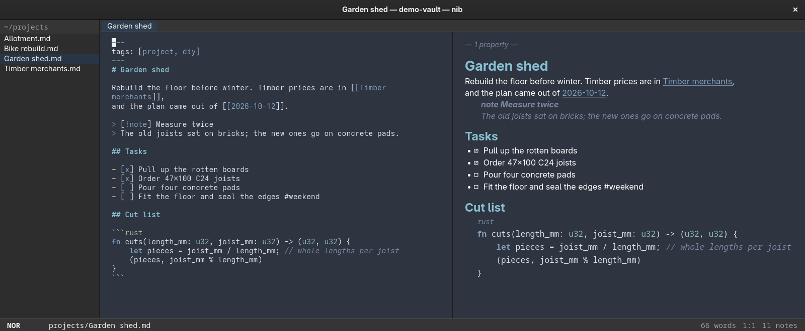

# nib

**Elevator pitch:** A keyboard-first Markdown notes app for Linux, in Rust, GTK 4 and GtkSourceView 5 — open an Obsidian vault as it is, write with vim motions, follow `[[wikilinks]]`, and find any note without leaving the keyboard.



## Features

- **Your Obsidian vault, unchanged.** Plain Markdown, shortest-unique wikilinks, frontmatter titles, aliases and tags, and the daily, templates and attachments folders you already have. Settings and sessions live outside the vault; `.obsidian/` is left alone.
- **Vim motions.** GtkSourceView's vim mode gives modes, motions, text objects, registers, search and undo, and nib adds its own `:` commands — `:w`, `:e!`, `:daily`, `:rename`, `:tag`. Turn it off with `editor.vim = false`; every action is still on a chord or in the palette.
- **Links that keep up.** `[[` and `#` complete note links and tags as you type; the right panel shows backlinks and an outline. A rename rewrites every reference to the note, keeping aliases and heading fragments.
- **Find anything.** `Alt+O` fuzzy-matches note names, `Alt+F` searches the whole vault and streams results as they are found, and `Alt+P` lists every command.
- **Source, reading and split views.** Callouts, local images, note embeds and task checkboxes that toggle from either view.
- **Code in its own colours.** Fenced code is highlighted in the language its fence names (` ```rust `, `~~~python` and about 30 more) in both the source and the reading view.
- **A files column like [trek](https://github.com/codedsleep/trek)'s.** `h` `j` `k` `l` to move, `v` and `Space` to select, `y` `x` `p` to yank, cut and paste, `d` to the trash can, `z` to fuzzy-find below a folder.
- **Daily notes and templates**, pasted screenshots, file attachments, tabs and a session per vault.
- **Careful with your files.** Saves are atomic and keep the BOM and line endings; non-UTF-8 files open read-only; a note changed on disk never overwrites the edits in its tab.
- **Your GTK theme.** Dark, in the desktop theme's colours — GTK 3-only themes included — with Nord and light editor schemes.

## Install

```sh
curl -fsSL https://raw.githubusercontent.com/codedsleep/nib/master/install.sh | bash
```

Downloads the latest release, verifies its checksum and installs the binary, a launcher, the icon, the man page, the editor schemes and nib's Markdown language under `~/.local`. The binary uses the system's GTK 4 (4.14 or later), GtkSourceView 5 (5.10 or later) and glibc (2.39 or later, as on Fedora 40, Ubuntu 24.04, Debian 13 and Arch) — x86_64 only.

```sh
... | bash -s -- --prefix /opt/nib    # install somewhere else
... | bash -s -- --version v0.2.1     # pin a release
... | bash -s -- --uninstall          # remove it again; config, sessions and notes stay
```

Prebuilt archives and `SHA256SUMS` are on the [releases page](https://github.com/codedsleep/nib/releases).

At run time it wants GTK 4 and GtkSourceView 5:

```sh
sudo dnf install gtk4 gtksourceview5                  # Fedora
sudo apt install libgtk-4-1 libgtksourceview-5-0      # Ubuntu, Debian
```

### From source

Requires Rust 1.92+, GTK 4.14+ and GtkSourceView 5.10+. This is the way in on aarch64. Fedora packages:

```sh
sudo dnf install gcc pkgconf-pkg-config gtk4-devel gtksourceview5-devel scdoc
```

```sh
git clone https://github.com/codedsleep/nib && cd nib
scripts/install.sh                  # build, then install into ~/.local
scripts/install.sh --uninstall
```

## Quickstart

```sh
nib                                  # the last vault; a folder chooser on first run
nib ~/Documents/notes                # open a vault
nib ~/Documents/notes/inbox.md       # open a note, in the window already running
nib --vault ~/Documents/notes --new 'A note'
nib --vault ~/Documents/notes --daily
nib --profile work ~/work/notes      # a separate instance, config and session
```

Press `F1` for every key and command, with a field that narrows the list as you type. `man nib` lists the command-line options.

### Default keybindings

| Key                                 | Action                                              |
| ----------------------------------- | --------------------------------------------------- |
| `Alt+O`, `Alt+F`, `Alt+P`           | open a note, search the vault, command palette      |
| `Alt+N`, `Alt+D`, `Alt+Shift+T`     | new note, today's daily note, insert a template     |
| `Alt+Enter`, `Alt+Left` `Alt+Right` | follow the link under the cursor; back, forward     |
| `Ctrl+Space`, `Ctrl+Enter`          | complete a link or tag; toggle a task               |
| `Alt+E`, `Alt+Shift+E`              | reading view; source and reading side by side       |
| `Alt+T` `Alt+W`, `Alt+[` `Alt+]`    | new tab, close it; previous, next                   |
| `Alt+1` `Alt+2` `Alt+3`             | focus the files column, the editor, the right panel |
| `F9` `F8` `F7`                      | show or hide the files column, right panel, parent  |
| `Ctrl+S`, `Ctrl+Q`                  | save, quit                                          |
| `F1`                                | every key and command                               |

In the files column:

| Key                                    | Action                                               |
| -------------------------------------- | ---------------------------------------------------- |
| `j` `k`, `gg` `G`, `Ctrl+D` `Ctrl+U`   | move the cursor                                      |
| `h` `l`, `H` `L`, `O`                  | parent folder, enter or open; back, forward; new tab |
| `Space`, `v`, `Ctrl+A` `Ctrl+R`, `Esc` | toggle, visual mode, select all, invert, clear       |
| `y` `x` `p` `P`                        | yank, cut, paste, paste over                         |
| `d`, `a`, `r`                          | trash; create (end with `/` for a folder); rename    |
| `/` `?` `n` `N`, `f`, `z`              | find, next, previous; filter; fuzzy-find below       |
| `c…`, `g…`, `,…`                       | copy a path or link; go to a folder; sort            |

The [full list](#all-keys) is below.

### Vim

GtkSourceView's vim mode handles the editing; nib owns its documented `:` commands. `:map` and `gf` are not supported, and substitution (`:s/a/b/`) is unreliable with GtkSourceView 5.20. An insert session is one undo step.

`Enter` continues a list and `Tab` `Shift+Tab` indent it. `Ctrl+V` pastes a screenshot in insert mode, or anywhere with vim off; `:paste-image` works in any mode. The reading view takes `j` `k` `gg` `G` `Ctrl+D` `Ctrl+U`, `Tab` and `Enter` for links, and `i` to go back to the source.

## Coming from Obsidian

Choose the vault folder you already have. nib reads plain Markdown, shortest-unique wikilinks, frontmatter titles, aliases and tags, and the existing daily, templates and attachments folders. It ignores `.obsidian/`, `.trash/`, `.git/` and `.nib/`, and keeps its settings and sessions outside the vault.

- **Daily notes** default to `daily/YYYY-MM-DD.md`.
- **Templates** fill in `{{date}}`, `{{time}}`, `{{title}}` and `{{date:FORMAT}}`; nothing in them is run.
- **Links.** `links.format` sets the form of new note and attachment links, relative paths included. An attachment link keeps its folder when two files share a name.
- **Not supported:** plugins, sync, remote images and running attachments. External links open only for `http`, `https` and `mailto`.

## Config

`:config` (or `Alt+P`) opens `~/.config/nib/nib.toml`, or `~/.config/nib/PROFILE/nib.toml` for `--profile PROFILE`; it is created on first use. Fonts, scheme, wrap, margins, vim and autosave apply when the file is saved; vault folders apply when the vault is next opened. Sessions and crash logs live under `~/.local/state/nib`, separately per profile. `XDG_CONFIG_HOME` and `XDG_STATE_HOME` move both.

### Theme

nib is dark, in the colours of the desktop's GTK theme. A theme with a GTK 4 part is loaded by GTK, in its dark variant when it has one. A theme written for GTK 3 only cannot be loaded by GTK 4, so nib takes the colours it names and recolours GTK 4's own stylesheet with them, as trek does. The editor and reading view take their colours from the style scheme (`nib-nord` or `nib-light`).

```sh
NIB_GTK_THEME=NordArc-Theme nib   # take colours from another theme for one run
GTK_THEME=Adwaita:light nib       # GTK's own light look for one run
```

### Environment

| Variable          | Effect                                                        |
| ----------------- | ------------------------------------------------------------- |
| `NIB_LOG`         | `debug`, `info`, `warn`, `error` or `off`                     |
| `NIB_TRACE=1`     | print timings to the terminal                                 |
| `NIB_GTK_THEME`   | the GTK theme to take colours from, in place of the desktop's |
| `NIB_ALLOW_ROOTS` | confine writes to the folders it lists, even when set empty   |

Normal use leaves `NIB_ALLOW_ROOTS` unset. `man nib` has the details.

## Safety

nib is meant to be trusted with a real vault. Still, back it up and look over the changes in your first week.

- **Saves are atomic** and keep the file's BOM and line endings. A file that is not UTF-8 opens read-only.
- **Changes on disk.** An external edit reloads a note with no unsaved edits. A note with edits shows a notice and waits for `:e!` (reload, dropping the edits) or `:w` (overwrite).
- **Unsaved edits are kept** when you move to another note with autosave off, when a save fails, or when the note changed on disk; save with `:w` or open another tab. Closing asks first. Past 32 tabs the least recently used clean tab closes; if every tab has edits, save or close one.
- **Renames** ask before rewriting references. **Deletes** go to the XDG trash can, and are refused when there is none.
- **Nothing is executed.** Attachments, `.desktop` files and scripts are never launched.

## Hyprland and Wayland notes

- The application id is `io.github.codedsleep.Nib`. A key binding: `bind = $mainMod, N, exec, nib`.
- One instance runs per profile; `nib PATH` from a terminal opens the note in that instance's window.

## All keys

Generated from the application registry by `scripts/generate-docs.py`. `F1` shows and filters the same list in the app. Files-column keys apply in that column.

<!-- registry:start -->

### Window and editor

| Keys              | Commands               | Action                                 |
| ----------------- | ---------------------- | -------------------------------------- |
| `Ctrl+S`          | `:w`, `:w!`, `:write`  | Save note                              |
| `Ctrl+Q`          | `:qa`, `:qa!`, `:qall` | Quit                                   |
| `Alt+T`           | `:tabnew`              | New tab                                |
| `Alt+W`           | —                      | Close the tab                          |
| `Alt+[`           | —                      | Previous tab                           |
| `Alt+]`           | —                      | Next tab                               |
| `Alt+Left`        | —                      | Back to the tab's previous note        |
| `Alt+Right`       | —                      | Forward to the tab's next note         |
| `Alt+D`           | `:daily`               | Today's daily note                     |
| `Alt+N`           | `:new`                 | New note                               |
| `Alt+Shift+T`     | `:template`            | Insert a template                      |
| `Alt+O`           | `:o`, `:open`          | Open a note (quick switcher)           |
| `Alt+P`           | —                      | Command palette                        |
| `Alt+F`           | `:find`                | Search the vault                       |
| `Alt+Enter`       | `:follow`              | Follow the link under the cursor       |
| `Ctrl+Enter`      | `:check`               | Toggle the task checkbox               |
| `Ctrl+Space`      | —                      | Complete the link or tag at the cursor |
| `Ctrl+Shift+Up`   | —                      | Promote the heading                    |
| `Ctrl+Shift+Down` | —                      | Demote the heading                     |
| `Alt+E`           | `:read`                | Reading view (toggle)                  |
| `Alt+Shift+E`     | `:split`               | Source and reading side by side        |
| `F9`              | `:files`               | Show or hide the files column          |
| `F8`              | —                      | Show or hide the right panel           |
| `F7`              | —                      | Show or hide the parent column         |
| `Alt+B`           | `:backlinks`           | Focus the backlinks                    |
| `F11`             | —                      | Fullscreen                             |
| `F5`              | —                      | Reload the folder listing from disk    |
| `F1`              | `:help`                | List every key and command             |
| `Alt+1`           | —                      | Focus the files column                 |
| `Alt+2`           | —                      | Focus the editor                       |
| `Alt+3`           | —                      | Focus the right panel                  |

### Files column

| Keys                        | Commands | Action                               |
| --------------------------- | -------- | ------------------------------------ |
| `j`, `<Down>`               | —        | Cursor down                          |
| `k`, `<Up>`                 | —        | Cursor up                            |
| `gg`, `<Home>`              | —        | First entry                          |
| `G`, `<End>`                | —        | Last entry                           |
| `<C-d>`                     | —        | Half a page down                     |
| `<C-u>`                     | —        | Half a page up                       |
| `<C-f>`, `<PageDown>`       | —        | A page down                          |
| `<C-b>`, `<PageUp>`         | —        | A page up                            |
| `h`, `<Left>`, `<BS>`       | —        | Parent folder                        |
| `l`, `<CR>`, `o`, `<Right>` | —        | Enter the folder or open the file    |
| `O`                         | —        | Open in a new tab                    |
| `H`                         | —        | Previous folder                      |
| `L`                         | —        | Next folder                          |
| `<Space>`                   | —        | Select or unselect, then step down   |
| `v`                         | —        | Visual selection mode                |
| `<C-a>`                     | —        | Select everything                    |
| `<C-r>`                     | —        | Invert the selection                 |
| `<Esc>`                     | —        | Clear the selection and the filter   |
| `y`                         | —        | Yank (copy) to the clipboard         |
| `x`                         | —        | Cut to the clipboard                 |
| `p`                         | —        | Paste here                           |
| `P`                         | —        | Paste here, replacing existing names |
| `Y`                         | —        | Forget the yank                      |
| `d`                         | —        | Move to the trash                    |
| `a`                         | —        | Create a note (name/ for a folder)   |
| `r`                         | —        | Rename (rewriting links)             |
| `/`                         | —        | Find in the list                     |
| `?`                         | —        | Find backwards                       |
| `n`                         | —        | Next match                           |
| `N`                         | —        | Previous match                       |
| `f`                         | —        | Filter the list                      |
| `z`                         | —        | Fuzzy-find below this folder         |
| `.`                         | —        | Show or hide hidden files            |
| `,n`                        | —        | Sort by name                         |
| `,m`                        | —        | Sort by modified time, showing ages  |
| `,r`                        | —        | Reverse the order                    |
| `cp`                        | —        | Copy the absolute path               |
| `cn`                        | —        | Copy the name                        |
| `cl`                        | —        | Copy a [[wikilink]]                  |
| `cr`                        | —        | Copy the vault-relative path         |
| `gh`                        | —        | Go to the vault root                 |
| `gd`                        | —        | Go to the daily folder               |
| `ga`                        | —        | Go to the attachments folder         |
| `gt`                        | —        | Go to the templates folder           |
| `gr`                        | —        | Recent notes                         |
| `~`                         | —        | List every key and command           |
| `<Tab>`                     | —        | Focus the editor                     |

### Commands and palette

| Keys | Commands       | Action                                      |
| ---- | -------------- | ------------------------------------------- |
| —    | `:wq`, `:x`    | Save and close the tab                      |
| —    | `:q`, `:quit`  | Close the tab                               |
| —    | `:q!`          | Close the tab, dropping changes             |
| —    | `:e`           | Open a note by name                         |
| —    | `:e!`          | Reload the note from disk, dropping changes |
| —    | `:rename`      | Rename (rewriting links)                    |
| —    | `:trash`       | Move to the trash                           |
| —    | `:tab`         | Tab N, new, close, next or prev             |
| —    | `:goto`        | Go to a line                                |
| —    | `:paste-image` | Paste an image as an attachment             |
| —    | `:attach`      | Attach files                                |
| —    | `:config`      | Edit nib.toml                               |
| —    | `:reindex`     | Index the vault again                       |
| —    | `:tag`         | Notes by tag                                |
| —    | `:edit`        | Back to the source (:edit NOTE opens one)   |
| —    | `:outline`     | Focus the outline                           |
| —    | `:version`     | Show nib's version                          |

<!-- registry:end -->

## Performance

Release builds, warm caches, on a generated 3,058-note / 40.2 MB vault. The ThinkPad is the target machine; workstation figures are development measurements. GUI timings on the ThinkPad are still to be taken.

| Metric                               | Budget       | Workstation         | ThinkPad               |
| ------------------------------------ | ------------ | ------------------- | ---------------------- |
| Parse a 5 KB note                    | 100 µs       | 5.24 µs median      | 15.4 µs median         |
| Completion key path                  | 50 µs        | 7.3 µs median       | 0.84 µs (core)         |
| Index 3,058 / 30,058 notes           | 400 ms / 4 s | 55.9 ms / 418 ms    | 204 ms / 1.69 s        |
| Search, first rows visible           | 100 ms       | 4.0 ms median       | 1.26 ms (first batch)  |
| Switcher visible / rows ranked       | 30 / 10 ms   | 8.4 / 5.9 ms median | 0.27 ms (core matcher) |
| Start to window mapped               | 150 ms       | 179 ms              | —                      |
| Open a 10,000-line note, first paint | 16 ms        | 14.6 ms             | —                      |
| Reading view, first part / whole     | 50 ms        | 18.9 / 84.2 ms      | 17.3 ms (render only)  |
| Files column, 20,000 entries         | 60 fps       | 7.9 ms worst frame  | 44.1 ms (listing)      |
| Idle memory, three tabs              | 90 MB        | 264.8 MB RSS        | —                      |

Two budgets are missed on the workstation, and recorded as misses. Start-up is mostly GTK's Vulkan initialisation on an RTX 4090 (about 110 ms); nib leaves the renderer to GTK. Idle memory is 158.3 MB PSS, of which graphics libraries account for 121 MB of the RSS. A long reading view shows its first 64 KB at once and finishes the rest in idle time.

## Development

```sh
scripts/mkfixture.sh --seed 7          # a test vault under ~/.cache/nib-fixture
scripts/dev-run.sh                     # nib on the fixture, with its own settings
scripts/check.sh                       # format, lints, tests, docs, release build, trace, smoke test
scripts/agent/checks/run-all.sh NAME   # chosen UI checks, driven by key presses in a headless session
python3 scripts/generate-docs.py       # regenerate the key tables here and in the man page
```

`dev-run.sh` and the headless checks set `NIB_ALLOW_ROOTS`, so a development session cannot write outside its own folders.

| Crate              | What it is                                                                                                            |
| ------------------ | --------------------------------------------------------------------------------------------------------------------- |
| `crates/nib-core`  | Pure note logic: parsing, links, frontmatter, fuzzy ranking, templates, reading-view rendering, settings. No I/O.     |
| `crates/nib-vault` | Everything that touches files: indexing, search, watching, saves, renames, trash, sessions, the theme reader. No GTK. |
| `crates/nib`       | The GTK 4 application.                                                                                                |

Releases are built by GitHub Actions when a `v*` tag is pushed.

## Acknowledgements

- [Obsidian](https://obsidian.md) — the vault format nib reads and writes, and the shape of the app.
- [GtkSourceView](https://gitlab.gnome.org/GNOME/gtksourceview) — the editor, its vim mode and the language definitions behind fenced-code highlighting.
- [trek](https://github.com/codedsleep/trek) — the files column, its keys and the GTK theme handling.
- [pulldown-cmark](https://crates.io/crates/pulldown-cmark) — Markdown parsing.
- [nucleo](https://crates.io/crates/nucleo) — fuzzy matching.
- [ignore](https://crates.io/crates/ignore) and [grep-searcher](https://crates.io/crates/grep-searcher) — walking and searching the vault the way ripgrep does.
- [notify](https://crates.io/crates/notify) — watching the vault for changes.
- [Nord](https://www.nordtheme.com) — the dark editor scheme.
- [gtk-rs](https://gtk-rs.org) — the Rust bindings for GTK 4, GLib and GIO.

## License

MIT; see [`LICENSE`](LICENSE).
